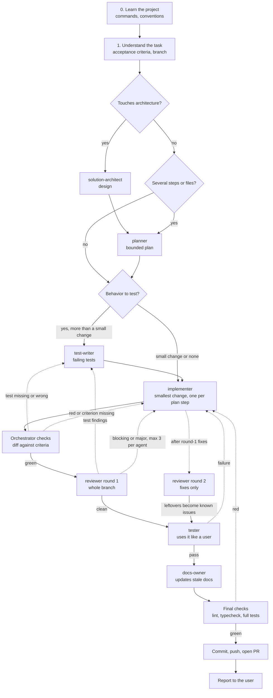

# agents-config

My personal collection of subagents, skills, and global instructions for [Claude Code](https://claude.com/claude-code) and [Codex](https://github.com/openai/codex), kept in one place and symlinked into each tool.

Third-party skills are not copied here: `skills.toml` lists where they live, and the installer fetches them from their authors' repos. See [Credits](#credits).

> `global/AGENTS.md` holds my own global rules. Installing replaces your `~/.claude/CLAUDE.md` and `~/.codex/AGENTS.md` (old files are backed up), so read it first.

## Requirements

The installer also sets up [mattpocock/skills](https://github.com/mattpocock/skills) unless you already have them: the Claude Code plugin, and for Codex the skills via [skills.sh](https://skills.sh) (needs `npx`). Nothing here depends on them, but they work well alongside. The plugin updates itself; update the Codex copies with `npx skills update -g`.

It also adds the MCP servers the agents use (`mcp.toml`) to both tools: Serena (needs [uv](https://docs.astral.sh/uv/)), Context7 (remote) and sequential-thinking (needs `npx`).

## Install

```bash
curl -fsSL https://raw.githubusercontent.com/steven-tailor/agents-config/main/install.sh | bash
```

Requires `git`, `bash`, and Python 3.11+. The script clones this repo into `~/.agents-config` (override with `AGENTS_CONFIG_DIR`), fetches the skills listed in `skills.toml`, and links your configs into it, so keep that folder.

Preview the changes first. The repo is still cloned, but your configs stay untouched:

```bash
curl -fsSL https://raw.githubusercontent.com/steven-tailor/agents-config/main/install.sh | bash -s -- --dry-run
```

## Update

Automatic: the installer adds a daily job (12:00, launchd on macOS, cron on Linux) that pulls the latest version and relinks. Log: `~/.agents-config/build/auto-update.log`.

Manual: run the install command again. To turn the daily job off:

```bash
~/.agents-config/install.sh --no-auto-update
```

Updates never delete what Claude Code, Codex or you created:

| What | On update |
| --- | --- |
| Your own agents and skills in `~/.claude` / `~/.codex` | untouched |
| Agents edited through the tool | kept, with a warning |
| Real files in the way | renamed to `<name>.backup-<timestamp>` |
| Local changes in `~/.agents-config` | update skipped |

## How ship works

`/ship` takes a task to a pull request. The main session orchestrates: it launches each agent, passes context between them, runs the final checks, and is the only one that commits. Open product or architecture decisions go to the user before any code is written. Dotted arrows are send-backs: at most 3 rounds for implementation, manual testing and final checks, at most 2 for review.

To keep token use low, the orchestrator does not read code itself. It passes file paths (design and plan live in `/tmp/ship-<branch>/`) and gives each fresh agent one small task: one plan step or at most 3 findings. Agents read line ranges, not whole files, and report in at most 30 lines. Implementation, test and docs agents run on Sonnet with medium effort; review and architecture stay on Opus.



## Credits

Third-party skills are fetched from their authors' repos at install time (see `skills.toml`). All credit goes to them:

- [openai/skills](https://github.com/openai/skills) (Apache-2.0): `linear`, `security-best-practices`, `security-ownership-map`
- [ayghri/i-have-adhd](https://github.com/ayghri/i-have-adhd) (MIT): `i-have-adhd`, installed with `disable-model-invocation` turned off
- [anthropics/skills](https://github.com/anthropics/skills) (Apache-2.0): `webapp-testing`, `frontend-design`
- [obra/superpowers](https://github.com/obra/superpowers) (MIT): `verification-before-completion`

If you wrote a skill here and want a different credit or want it removed, open an issue.

## License

My own work here (the install script, the scripts, the agents, the `ship` skill and the docs) is released into the public domain under [the Unlicense](LICENSE). Use it however you like, no attribution needed.

Third-party skills keep their original licenses.
